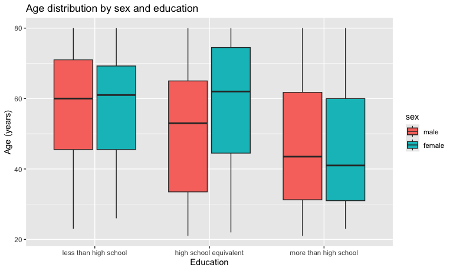
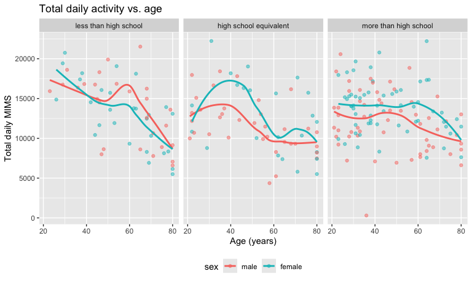
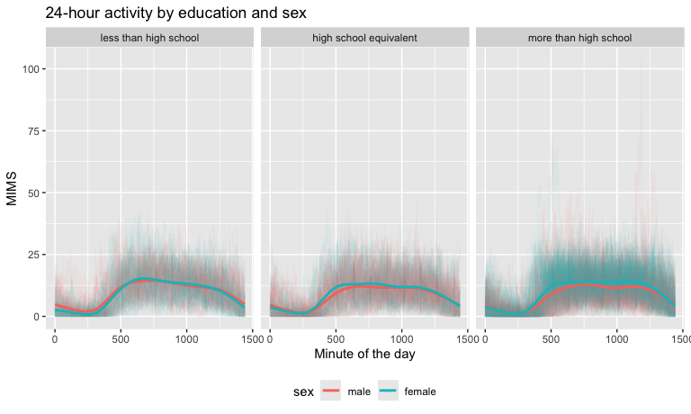

P8105_HW3-sri2121
================
Sameera
2026-10-19

Loading libraries

## Problem 2

Loading, tidying, merging data:

``` r
covar_df =
  read_csv("./data/nhanes_covar.csv", skip = 4) |>
  janitor::clean_names()
```

    ## Rows: 250 Columns: 5
    ## ── Column specification ────────────────────────────────────────────────────────
    ## Delimiter: ","
    ## dbl (5): SEQN, sex, age, BMI, education
    ## 
    ## ℹ Use `spec()` to retrieve the full column specification for this data.
    ## ℹ Specify the column types or set `show_col_types = FALSE` to quiet this message.

``` r
accel_df =
  read_csv("./data/nhanes_accel.csv") |>
  janitor::clean_names()
```

    ## Rows: 250 Columns: 1441
    ## ── Column specification ────────────────────────────────────────────────────────
    ## Delimiter: ","
    ## dbl (1441): SEQN, min1, min2, min3, min4, min5, min6, min7, min8, min9, min1...
    ## 
    ## ℹ Use `spec()` to retrieve the full column specification for this data.
    ## ℹ Specify the column types or set `show_col_types = FALSE` to quiet this message.

``` r
nhanes_df = inner_join(covar_df, accel_df, by = "seqn")

nhanes_df =
  nhanes_df |>
  filter(age >= 21) |>
  drop_na(sex, age, bmi, education) |>
  mutate(
    seqn = as.character(seqn),
    sex = case_match(
      sex,
      1 ~ "male",
      2 ~ "female"),
    sex = factor(sex, levels = c("male", "female")),
    education = case_match(
      education,
      1 ~ "less than high school",
      2 ~ "high school equivalent",
      3 ~ "more than high school"),
    education = factor(
      education,
      levels = c("less than high school",
                 "high school equivalent",
                 "more than high school")))
```

    ## Warning: There was 1 warning in `mutate()`.
    ## ℹ In argument: `sex = case_match(sex, 1 ~ "male", 2 ~ "female")`.
    ## Caused by warning:
    ## ! `case_match()` was deprecated in dplyr 1.2.0.
    ## ℹ Please use `recode_values()` instead.

``` r
nhanes_df
```

    ## # A tibble: 228 × 1,445
    ##    seqn  sex      age   bmi education     min1   min2   min3  min4   min5   min6
    ##    <chr> <fct>  <dbl> <dbl> <fct>        <dbl>  <dbl>  <dbl> <dbl>  <dbl>  <dbl>
    ##  1 62161 male      22  23.3 high school… 1.11  3.12   1.47   0.938 1.60   0.145 
    ##  2 62164 female    44  23.2 more than h… 1.92  1.67   2.38   0.935 2.59   5.22  
    ##  3 62169 male      21  20.1 high school… 5.85  5.18   4.76   6.48  6.85   7.24  
    ##  4 62174 male      80  33.9 more than h… 5.42  3.48   3.72   3.81  6.85   4.45  
    ##  5 62177 male      51  20.1 high school… 6.14  8.06   9.99   6.60  4.57   2.78  
    ##  6 62178 male      80  28.5 high school… 0.167 0.429  0.131  1.20  0.0796 0.0487
    ##  7 62180 male      35  27.9 more than h… 0.039 0      0      0     0.369  0.265 
    ##  8 62184 male      26  22.1 high school… 1.55  2.81   3.86   4.76  6.10   7.61  
    ##  9 62189 female    30  22.4 more than h… 2.81  0.195  0.163  0     0.144  0.180 
    ## 10 62199 male      57  28   more than h… 0.031 0.0359 0.0387 0.079 0.109  0.262 
    ## # ℹ 218 more rows
    ## # ℹ 1,434 more variables: min7 <dbl>, min8 <dbl>, min9 <dbl>, min10 <dbl>,
    ## #   min11 <dbl>, min12 <dbl>, min13 <dbl>, min14 <dbl>, min15 <dbl>,
    ## #   min16 <dbl>, min17 <dbl>, min18 <dbl>, min19 <dbl>, min20 <dbl>,
    ## #   min21 <dbl>, min22 <dbl>, min23 <dbl>, min24 <dbl>, min25 <dbl>,
    ## #   min26 <dbl>, min27 <dbl>, min28 <dbl>, min29 <dbl>, min30 <dbl>,
    ## #   min31 <dbl>, min32 <dbl>, min33 <dbl>, min34 <dbl>, min35 <dbl>, …

Education and sex table:

``` r
nhanes_df |>
  count(education, sex) |>
  pivot_wider(
    names_from = sex,
    values_from = n) |>
  knitr::kable()
```

| education              | male | female |
|:-----------------------|-----:|-------:|
| less than high school  |   27 |     28 |
| high school equivalent |   35 |     23 |
| more than high school  |   56 |     59 |

Men and women are about evenly split in the “less than high school”
group (27 men, 28 women) and the “more than high school” group (56 men,
59 women). In the “high school equivalent” group there are more men than
women (35 vs. 23). The “more than high school” group is by far the
largest, with 115 participants.

Plot:

``` r
nhanes_df |>
  ggplot(aes(x = education, y = age, fill = sex)) +
  geom_boxplot() +
  labs(
    title = "Age distribution by sex and education",
    x = "Education",
    y = "Age (years)")
```



Total activity and age:

``` r
nhanes_long_df =
  nhanes_df |>
  pivot_longer(
    min1:min1440,
    names_to = "minute",
    names_prefix = "min",
    values_to = "mims") |>
  mutate(minute = as.numeric(minute))

total_df =
  nhanes_long_df |>
  group_by(seqn, sex, age, education) |>
  summarize(total_activity = sum(mims))
```

    ## `summarise()` has regrouped the output.
    ## ℹ Summaries were computed grouped by seqn, sex, age, and education.
    ## ℹ Output is grouped by seqn, sex, and age.
    ## ℹ Use `summarise(.groups = "drop_last")` to silence this message.
    ## ℹ Use `summarise(.by = c(seqn, sex, age, education))` for per-operation
    ##   grouping (`?dplyr::dplyr_by`) instead.

``` r
total_df |>
  ggplot(aes(x = age, y = total_activity, color = sex)) +
  geom_point(alpha = .5) +
  geom_smooth(se = FALSE) +
  facet_grid(. ~ education) +
  labs(
    title = "Total daily activity vs. age",
    x = "Age (years)",
    y = "Total daily MIMS") +
  theme(legend.position = "bottom")
```

    ## `geom_smooth()` using method = 'loess' and formula = 'y ~ x'



Total activity generally decreases with age for both sexes in all three
education groups. The decline is steepest in the “less than high school”
group. The decline is weakest in the “more than high school” group.

24 hour activity, 3 panel plot:

``` r
nhanes_long_df |>
  ggplot(aes(x = minute, y = mims, color = sex)) +
  geom_line(aes(group = seqn), alpha = .05) +
  geom_smooth(aes(group = sex), se = FALSE) +
  facet_grid(. ~ education) +
  labs(
    title = "24-hour activity by education and sex",
    x = "Minute of the day",
    y = "MIMS") +
  theme(legend.position = "bottom")
```

    ## `geom_smooth()` using method = 'gam' and formula = 'y ~ s(x, bs = "cs")'



All three education groups follow the same daily pattern. Activity is
very low overnight, rises sharply in the early morning, stays high
through the daytime, and drops off in the evening. Women tend to have a
slightly earlier or higher morning rise than men in each group. In the
“more than high school” group, women stay active through the afternoon
and early evening while men’s activity declines, so the two smooth
curves separate. In the other two groups the curves for men and women
are close together for most of the day. Because the individual-level
lines are very noisy, the smooths are the easiest way to compare groups.
